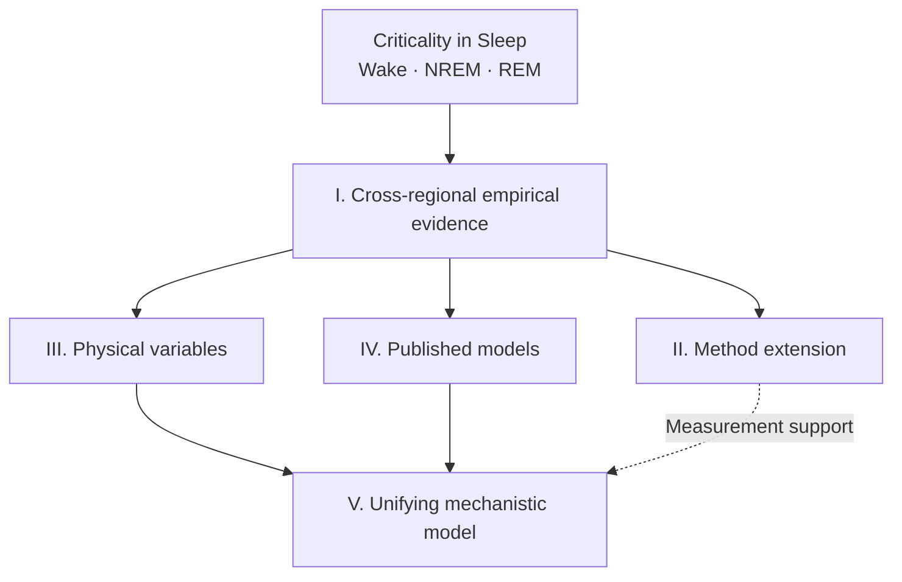

# Criticality in Sleep

**State-dependent proximity to criticality across sleep states and brain regions**

睡眠状态下的神经临界性与动力学机制

[](https://lifescience-lyyyyyy.github.io/Criticality-in-Sleep/)
[](https://lifescience-lyyyyyy.github.io/Criticality-in-Sleep/)

> [!TIP]
> **在线交互脑图谱（Sleep Criticality Atlas）**：无需进入代码仓库，直接访问 **[https://lifescience-lyyyyyy.github.io/Criticality-in-Sleep/](https://lifescience-lyyyyyy.github.io/Criticality-in-Sleep/)** 即可在线交互浏览小鼠（Allen CCFv3 矢状/冠状切片）与大鼠各脑区在 Wake、NREM 和 REM 状态下的临界距离 $d_2$、逐动物配对分布、稳健性对照与完整数据溯源。

本项目研究 Wake、NREM 和 REM 状态下，不同脑区的神经活动与临界态的距离如何变化，以及这些变化背后的动力学机制。以 Sooter 等人的信息论临界距离估计器为起点，从跨脑区实证研究出发，逐步开展方法推广、物理量分析和已有模型检验，最终探索能够解释经验结果的共同机制。

[在线交互脑图谱](https://lifescience-lyyyyyy.github.io/Criticality-in-Sleep/) · [跨脑区研究汇总](reports/30_preliminary_research_summary.md) · [动力学图谱](research/criticality_dynamics_atlas/REPORT_zh.md) · [神经元级模型](research/neuron_rnn_criticality/REPORT_zh.md)

## Research Framework | 研究框架



| 研究模块 | 核心问题 | 当前进展 |
| --- | --- | --- |
| I. Cross-regional empirical evidence | 睡眠状态下的临界距离变化能否在不同脑区重复观察到？ | 已建立初步跨脑区证据与在线交互脑图谱 |
| II. Method extension | 能否将临界距离估计推广至不同类型的神经信号？ | 已开展估计器诊断与敏感性分析；跨模态推广尚未完成 |
| III. Physical variables | 临界距离与时间尺度、波动和群体动力学等物理量有什么关系？ | Empirical Atlas 第一轮已完成 |
| IV. Published models | 已发表的神经动力学模型能否自然产生观察到的临界距离变化？ | Jercog 与 Bugnon 的基础复现及临界距离分析已完成 |
| V. Unifying mechanistic model | 能否通过共同的动力学机制解释上述经验结果？ | 尚未建立，以实证和已有模型结果为约束 |

各模块围绕同一个研究问题展开。统一机制模型是待检验的研究目标，而不是预设结论。

## Interactive Atlas | 在线交互脑图谱

**网站地址：<https://lifescience-lyyyyyy.github.io/Criticality-in-Sleep/>**

交互脑图谱（位于 [`website/`](website/)，由 GitHub Pages 自动构建部署）支持按脑区、数据源与独立动物检视可复现的睡眠电生理结果：

- **交互式解剖视图**：小鼠数据基于 Allen CCFv3 真实矢状面与冠状面参考切片着色，大鼠数据提供独立队列入口。
- **同场配对与多视角对比**：支持切换 `Wake / NREM`、`NREM / REM`、`Wake / REM` 及三态视图，直观展示逐动物配对变化 $\Delta d_2$ 与正向/负向分布。
- **质量控制与敏感性分析**：内置 `AR(10)`、等时长、边界裁剪、严格单元、放电率/单元数配平及排序子集敏感性对照，并附完整 MATLAB 运行与原始拟合溯源链接。

## I. Cross-regional Empirical Evidence | 跨脑区实证研究

在固定 Gaussian AR 估计规格下，多个独立的小鼠和大鼠数据来源显示，NREM 的临界距离 $d_2$ 往往高于 Wake 和 REM；Wake 与 REM 的相对排序不统一。

- 小鼠 V1：复现 Sooter 等人的 Wake–NREM 比较，13 个会话方向一致，独立动物数未知。
- 小鼠 PoSub：成对等时 Wake–NREM 队列中，29 只动物有 27 只呈现 NREM $d_2$ 增加。
- 小鼠 ADN、CA1、PAG 及部分大鼠额叶记录提供进一步的区内配对证据。
- 斑胸草雀 LMAN：当前结果属于诊断性分析，严格单元配对缺少合格群体，不作为已确立的跨物种证据。

主要结果及资料：

- [在线交互脑图谱](https://lifescience-lyyyyyy.github.io/Criticality-in-Sleep/)
- [跨脑区初步科学证据](reports/30_preliminary_research_summary.md)
- [成对等时与科学审计](reports/29_preliminary_validation.md)
- [小鼠 V1 复现图](figures/pnas/mouse_wake_nrem.pdf)
- [睡眠临界性脑图谱发布说明](reports/31_atlas_release_notes.md)
- [图谱运行与数据说明](reports/27_sleep_criticality_atlas_data.md)

## II. Method Extension | 方法推广

研究现有临界距离估计器的适用范围，考察 Gaussian AR 模型假设、非高斯动力学、时间分辨率、神经元子采样和连续记录长度对估计结果的影响，并探索向其他神经信号类型（如 LFP、EEG 和钙成像）的推广。

当前已开展 AR 阶数、分箱、观测尺度、残差诊断及统计代理对照。跨模态估计方法尚未完成，不将不同信号类型的数值直接视为可比。

- [原始 MATLAB 估计器](https://github.com/sam-sooter/prox_crit_toolkit)
- [针对性验证](reports/26_targeted_validation.md)
- [成对等时与方法学审计](reports/29_preliminary_validation.md)
- [理论零假设与动力学指标诊断](research/criticality_dynamics_atlas/REPORT_zh.md)

## III. Physical Variables | 临界距离与动力学物理量

**Criticality–Dynamics Empirical Atlas**

研究临界距离与单神经元和群体时间尺度、MR 有效衰减参数、群体有效维度、协方差结构、Fano factor、频谱和间歇性活动的关系，并将经验结果与经典临界慢化理论及最小随机过程对照。

第一轮图谱包含 1,229 条状态观测、69 个按数据集去重的动物 ID、158 个会话 ID 和 21 个归档脑区标签。部分记录在不同分析层重复出现，不将观测行数作为独立生物学样本量。

### 代表性等时配对结果

| 队列（NREM − Wake） | 动物数 | Δd₂ (bits/s) | 群体积分 Δτ (s) |
| --- | ---: | ---: | ---: |
| PoSub | 29 | +1.249 | −0.361 |
| ADN | 7 | +0.860 | −0.154 |
| 小鼠 CA1 | 6 | +0.851 | −0.164 |

多个队列呈现 NREM 时间尺度缩短而群体波动增强的现象。PoSub 的同细胞指数时间尺度平均缩短 0.171 s，群体 Fano factor 平均增加 3.261。

这些结果提供了后续机制模型的经验约束，但部分指标共享同一时间相关结构，相关性不能直接解释为独立的因果机制。不同脑区的变化也不必具有统一幅度或方向。

[研究报告](research/criticality_dynamics_atlas/REPORT_zh.md) · [复现说明](research/criticality_dynamics_atlas/README.md) · [实验假说](research/criticality_dynamics_atlas/hypotheses.md) · [结果文件](research/criticality_dynamics_atlas/results/) · [图表](research/criticality_dynamics_atlas/figures/)

## IV. Published Models | 已有神经动力学模型检验

**Neuron-level Recurrent Network Criticality Benchmark**

优先使用原生尖峰输出的神经元级递归网络。在保留作者动力学参数的基础上，先复现原论文的基本生理现象，再使用与真实神经数据相同的临界距离估计方法检验模型。

| 模型 | 原始研究目标 | 当前结果 |
| --- | --- | --- |
| [Jercog et al., 2017](https://doi.org/10.7554/eLife.22425) | 双稳态 E/I 网络与 UP/DOWN 动力学 | 5,000 个 LIF 单元，三组配对网络实例；基础生理复现通过，已完成 $d_2$、参数扰动及脉冲响应分析 |
| [Bugnon et al., 2024](https://doi.org/10.1111/ejn.15836) | 丘脑–皮层网络的 Wake/Sleep-like 动力学 | 23,816 个记录皮层单元；单个配对网络实例，两态各完成 120 s 稳定模拟及基础生理验收，正式 $d_2$ 分析使用首个 60 s |

Jercog 的两个作者条件不是 Wake/NREM 分期，其结果表明相似的 $d_2$ 可以伴随不同的网络扰动响应。Bugnon 的全群体 AR(5) 估计中 Sleep-like 的 $d_2$ 低于 Wake，而 AR(10) 下差异很小且方向反转。当前结果不足以证明已有睡眠模型能够普遍重现真实数据中的状态排序，也不足以否定原模型的生理解释。

- [神经元级模型研究报告](research/neuron_rnn_criticality/REPORT_zh.md)
- [运行与复现说明](research/neuron_rnn_criticality/README.md)
- [比较协议](research/neuron_rnn_criticality/protocol.md) · [模型登记](research/neuron_rnn_criticality/registry.json)
- [结果](research/neuron_rnn_criticality/results/) · [图表](research/neuron_rnn_criticality/figures/)
- [早期均场模型与其他睡眠模型基准](research/sleep_model_benchmark/README.md)

## V. Unifying Mechanistic Model | 统一机制模型

本项目最终希望提出一个具有明确神经动力学含义、能够在不同睡眠状态及脑区间检验的机制模型。

模型设计将由以下证据共同约束：跨脑区临界距离的状态差异、时间尺度与群体动力学的经验关系、以及已有神经元级模型的成功与局限。目标是检验可推广的动力学机制，而不是通过直接拟合 $d_2$ 来重现预设的状态排序。

**当前状态：尚未建立正式统一模型。**

## Methodology | 估计方法与解释范围

主要分析复用 [Sooter 等人的 PNAS 论文](https://doi.org/10.1073/pnas.2526984123) 对应的 [MATLAB 工具包](https://github.com/sam-sooter/prox_crit_toolkit)。

| 参数 | 主规格 |
| --- | --- |
| MATLAB | R2024b |
| 工具包固定提交 | `f26c782dca3b1c9ab18cc92c6449591c44e0d507` |
| 观测变量 | Population spike counts |
| 时间分箱 | 40 ms |
| AR 模型 | Yule–Walker AR(5) |
| 临界流形参数 | $\beta = 2$ |
| 输出单位 | bits/s |
| 敏感性规格 | AR(10) 及适用的其他时间尺度、采样和观测对照 |

这里的 $d_2$ 表示特定 Gaussian AR 模型族下到参考临界流形的距离，而非对真实神经网络物理相变的直接测量。数值求解成功不等同于满足 Gaussian sufficiency。实证推断以动物为主要独立单位，独立动物数未知时保留会话口径；模型实例与技术重复分别报告。不将不连续睡眠片段直接拼接成连续时间序列。

## Reproduction | 运行与复现

```bash
git clone https://github.com/Lifescience-Lyyyyyy/Criticality-in-Sleep.git
cd Criticality-in-Sleep
```

| 任务 | 入口 |
| --- | --- |
| 在线交互脑图谱 | [项目网站](https://lifescience-lyyyyyy.github.io/Criticality-in-Sleep/) · [构建说明](reports/31_atlas_release_notes.md) · [website/](website/) · [部署工作流](.github/workflows/atlas-pages.yml) |
| 基础复现及真实睡眠分析 | [MATLAB PNAS Replication](https://github.com/Lifescience-Lyyyyyy/Criticality-in-Sleep/actions/workflows/matlab.yml) |
| 数据准备 | [Drive 初始化](notebooks/00_drive_setup.ipynb) · [小鼠](notebooks/01_mouse_data.ipynb) · [斑胸草雀](notebooks/02_zebra_data.ipynb) |
| 经验动力学图谱 | [复现说明](research/criticality_dynamics_atlas/README.md) · [Actions](https://github.com/Lifescience-Lyyyyyy/Criticality-in-Sleep/actions/workflows/dynamics-atlas.yml) |
| 神经元级模型 | [复现说明](research/neuron_rnn_criticality/README.md) · [Actions](https://github.com/Lifescience-Lyyyyyy/Criticality-in-Sleep/actions/workflows/neuron-rnn-criticality.yml) |

本地预览交互脑图谱（建议在 WSL 中运行）：

```bash
cd website
npm ci
npm run dev      # 本地开发预览
npm run build    # 生产构建
npm test         # Playwright 端到端测试
```

本地开发使用 WSL，数据准备使用 Colab，原始数据、运行日志及大型计算归档保存在项目 Google Drive。仓库更名不改变原有 `MyDrive/Research/Criticality_Evolution/` 路径和历史实验校验记录。在线交互脑图谱已通过 GitHub Pages 部署于 <https://lifescience-lyyyyyy.github.io/Criticality-in-Sleep/>。

## Repository Structure | 仓库结构

```text
Criticality-in-Sleep/
├── notebooks/                 # Colab 数据准备
├── scripts/                   # 数据处理、分析与复现
├── config/                    # 实验配置
├── manifests/                 # 数据来源、实验记录与校验值
├── reports/                   # 历史阶段报告及实证研究
├── results/                   # 实证分析结果
├── figures/                   # 实证分析图表
├── research/
│   ├── criticality_dynamics_atlas/
│   ├── neuron_rnn_criticality/
│   └── sleep_model_benchmark/
├── website/                   # 交互脑图谱（GitHub Pages 源码）
└── .github/workflows/         # MATLAB 与网站工作流
```

## Research History | 历史阶段与复现记录

<details>
<summary>展开早期复现与 Phase 7–11.1 的详细记录</summary>

### 初始复现与斑胸草雀重分析

用 Sooter 等人的 MATLAB 工具包复现小鼠 V1 的 Wake–NREM 比较。斑胸草雀 LMAN 重分析按亮灯活动、亮灯非活动和评分 SWS 组织。严格单元配对缺少合格群体，当前的鸟数据结果用于诊断。历史两态分析已由 [v2](reports/04_zebra_analysis.md) 替换，可从 [历史标签](https://github.com/Lifescience-Lyyyyyy/Criticality-in-Sleep/tree/pre-zebra-reanalysis-20261120) 复算。

- 在 [MATLAB PNAS Replication](https://github.com/Lifescience-Lyyyyyy/Criticality-in-Sleep/actions/workflows/matlab.yml) 手动选择 `smoke`、`synthetic`、`mouse`、`zebra` 或 `sleep`。对应的 `matlab-smoke-*`、`matlab-synthetic-*`、`matlab-mouse-*`、`matlab-zebra-*`、`matlab-sleep-*` 标签也能触发。运行完成后下载 `matlab-results`。
- [Drive 初始化](notebooks/00_drive_setup.ipynb) 和 [小鼠数据准备](notebooks/01_mouse_data.ipynb) 在 Colab 执行。原始数据和运行归档位于 `MyDrive/Research/Criticality_Evolution/`。
- 复用 Drive 中的斑胸草雀源文件。若缺少原始文件，在 WSL 运行 `python3 scripts/data/stage_zebra_sources.py --session <已挂载 Drive 的 Colab 会话名>`。缺少四个补充文件时加 `--supplement-only`。在 Colab 运行[数据准备 notebook](notebooks/02_zebra_data.ipynb)，生成 `matlab_inputs/zebra_lman_reanalysis_v2.mat` 和 `manifests/zebra-finch-preparation-v2.json`，以及 `processed/zebra_finch/lman-burst-events-v2.json`。校验 SHA 后更新 Git 计数文件及同名 `.sha256`，再运行 MATLAB `zebra` 阶段。
- 下载新运行产物中的 `zebra_finch_reanalysis.json`，在 Colab 环境从仓库根目录合并并绘图。历史复算清单也可从正式发布 JSON 的 `historical_reproduction` 字段恢复。

```bash
python scripts/analysis/summarize_zebra.py path/to/zebra_finch_reanalysis.json \
  manifests/zebra-finch-preparation.json path/to/zebra-baseline-repeat.json \
  results/zebra_finch/lman.json
python scripts/analysis/plot_zebra.py
```

- [中文总报告](reports/05_final_summary.md) · [小鼠 Wake–NREM 图](figures/pnas/mouse_wake_nrem.pdf)
- 斑胸草雀诊断图：[三态 d₂](figures/zebra_finch/lman_state_comparison.pdf) · [发放统计](figures/zebra_finch/lman_firing_statistics.pdf) · [爆发统计](figures/zebra_finch/lman_burst_statistics.pdf) · [SWS 爆发与 d₂](figures/zebra_finch/lman_burst_d2.pdf) · [敏感性](figures/zebra_finch/lman_sensitivity.pdf)
- [来源清单](manifests/sources.json) · [斑胸草雀准备清单](manifests/zebra-finch-preparation.json) · [实验记录和校验值](manifests/experiments.json)

### Phase 7 数据审计

RA 的 OSF 发布含四只斑胸草雀的双侧排序脉冲。睡眠时段、鸣唱与重放缺少可对齐到神经时钟的标注，RA-0 受阻。三个爬行动物数据源的公开资料也尚不足以开展本项目的群体脉冲 d₂ 分析。

- [RA 可行性](reports/07_ra_feasibility.md) · [Phase 7 科学结论与验证顺序](reports/08_ra_analysis.md) · [RA–LMAN 可比范围](reports/09_ra_lman_comparison.md)
- [爬行动物数据审计](reports/10_reptile_data_audit.md) · [RA 来源清单](manifests/ra-source.json) · [爬行动物来源清单](manifests/reptile-source.json)
- 重跑 OSF 只读清单和文件头检查可用 `python3 scripts/data/inspect_ra.py`。

### Phase 8 自发睡眠

新增大鼠家笼额叶、同录的大鼠 CA1–BLA，以及睡眠与刺激边界明确的小鼠家笼 CA1。各来源以发布版固定，保留作者 Wake 标签。动物是独立比较单位，区域同录对照按 PRE／POST 分开。

- [资格审计](reports/11_sleep_datasets_feasibility.md) · [真实数据试跑](reports/12_sleep_pilot.md) · [区域内结果](reports/13_sleep_within_region.md) · [同期区域对照](reports/14_sleep_cross_region.md) · [NREM 涟漪](reports/15_sleep_events.md) · [科学总结](reports/16_sleep_project_summary.md)
- [逐资产资格 CSV](manifests/sleep_dataset_eligibility.csv) · [来源与版本](manifests/sleep_sources.json) · [运行与 SHA-256](manifests/sleep_experiments.json) · [完整 Drive 归档](https://drive.google.com/drive/folders/1sy_0Tjej6YiUCTJZ-AL9_GUtsnE5fXPL)
- 在 Colab 安装 `remfile==0.1.16`，从仓库根目录运行 `python scripts/data/audit_sleep_dandi.py --out <Drive 项目>/manifests/sleep_dandi`。随后用 `scripts/data/prepare_sleep_dandi.py` 的 `--audit` 和 `--dandiset` 选择合格队列，也可用 `--asset` 限定单会话。新增 `sleep` 工作流阶段读取经过校验的计数与收据。仓库提供 ACC 试跑 fixture，完整批次保存在项目 Drive，对应 Git 标签保留每次运行的准确输入和代码。
- `--paired-regions` 选择同录 CA1–BLA。对应 `--events` 和 `--controls` 分别准备涟漪和重复对照。`--rem-from-fixtures` 从验证过的三套计数 fixture 匹配三态时长。用 `scripts/analysis/summarize_sleep_dandi.py` 汇总 MATLAB JSON，以 `scripts/analysis/plot_sleep_dandi.py` 生成逐动物图。
- 估计使用原始 MATLAB 版本、40 ms、AR(5)、β=2 和 Yule–Walker，0.40 秒跨度及适用的额外控制另存。只读 NWB 排序脉冲及小型注释表，连续区间分别传给估计器。

### Phase 9 CRCNS 睡眠回路

- [逐会话资格审计](reports/17_phase9_data_feasibility.md) · [新分析结果](reports/19_phase9_sleep_results.md) · [跨脑区总结](reports/20_cross_region_sleep_summary.md) · [hc-24 NREM 结果](reports/21_hc24_nrem.md)
- [来源和校验](manifests/phase9_sources.json) · [资格 CSV](manifests/phase9_dataset_eligibility.csv) · [Actions 实验清单](manifests/phase9_experiments.json)
- 新增手动 `crcns` 阶段，复用固定的 Sooter MATLAB 估计器和原有分段诊断。仓库默认提供可重跑的 hc-23 MEC 试跑计数，源脉冲不进入 Git。图和中文报告按动物汇总，PRE／POST 分开。
- 用 `scripts/data/audit_crcns_sleep.py --hc23-overnight <排序脉冲缓存.zip> --hc23-mat <作者文件.mat> --out <审计.json>` 核验 Figshare。随后运行 `scripts/data/prepare_crcns_sleep.py` 并传入该审计、原 MAT 和排序脉冲缓存。复算时通过流水线核对输入 SHA-256。其 `--verified-index` 入口也可接收已过数据与评分门槛的 MATLAB／NeuroSuite 或 NWB 会话。
- 用 `scripts/data/prepare_hc24.py --archive <CRCNS data.zip> --audit <审计.json> --out <计数.mat>` 核验 hc-24，并复算作者 NREM 区间的 40 ms 计数。可用 `--session` 限定一个会话。

### Phase 10 自发睡眠跨脑区分析

- [五个来源逐会话的数据审计](reports/22_phase10_dataset_audit.md) · [MATLAB 试点](reports/23_phase10_pilot.md) · [逐动物队列与敏感性分析](reports/24_phase10_multiregion_results.md) · [科学结论](reports/25_phase10_scientific_summary.md)
- [固定版本与许可](manifests/phase10_sources.json) · [资格 CSV](manifests/phase10_eligibility.csv) · [Actions 运行和派生计数指纹](manifests/phase10_experiments.json)
- 手动 `phase10` 工作流默认复跑一个真正的 ADN 试点。批次标签保留每次拟合的输入与代码。MATLAB R2024b 调用固定 Sooter 估计器，状态片段分开，主规格为 40 ms、AR(5)、β=2 和 Yule–Walker。
- DANDI 输入由 `scripts/data/prepare_phase10.py` 按固定资产读取脉冲、分期及信号时钟。脑干输入由 `scripts/data/prepare_phase10_brainstem.py` 核验选定 ZIP 成员的 1 ms 数组。聚合图及数值由 `scripts/analysis/summarize_phase10.py` 和 `scripts/analysis/plot_phase10.py` 生成。

### Phase 11 睡眠临界性脑图谱

中文交互图谱位于 `website/`，已在线部署于 [https://lifescience-lyyyyyy.github.io/Criticality-in-Sleep/](https://lifescience-lyyyyyy.github.io/Criticality-in-Sleep/)。小鼠版使用 Allen CCFv3 实际矢状和冠状切片，大鼠有独立数据入口。数据从原 MATLAB 拟合和来源清单导出。Phase 11 针对性核验保留原参考值并独立发布敏感性结果。

[图谱运行与 GitHub Pages 配置](reports/27_sleep_criticality_atlas_data.md) · [针对性验证](reports/26_targeted_validation.md) · [研究汇总](reports/28_research_consolidation.md)

### Phase 11.1 初步证据与图谱发布

[成对等时与科学审计](reports/29_preliminary_validation.md) · [跨脑区初步证据](reports/30_preliminary_research_summary.md) · [图谱发布说明](reports/31_atlas_release_notes.md) · [运行及校验清单](manifests/phase11_1_release.json)

</details>

## References | 主要参考文献

- Sooter et al. — *Defining and measuring proximity to criticality based on univariate time series*. [PNAS](https://doi.org/10.1073/pnas.2526984123) · [Code](https://github.com/sam-sooter/prox_crit_toolkit)
- Murray et al. (2014) — *A hierarchy of intrinsic timescales across primate cortex*. [Nature Neuroscience](https://doi.org/10.1038/nn.3862)
- Wilting & Priesemann (2018) — *Inferring collective dynamical states from widely unobserved systems*. [Nature Communications](https://doi.org/10.1038/s41467-018-04725-4)
- Jercog et al. (2017) — *UP-DOWN cortical dynamics reflect state transitions in a bistable network*. [eLife](https://doi.org/10.7554/eLife.22425) · [Code](https://github.com/djercog/JercogEtAl2017)
- Bugnon et al. (2024) — *Sleep and wake in a model of the thalamocortical system with Martinotti cells*. [European Journal of Neuroscience](https://doi.org/10.1111/ejn.15836) · [Code](https://github.com/TomBugnon/MC_sleep_replicate)
- Lorenz et al. — [斑胸草雀原始记录](https://doi.org/10.12751/g-node.vsxyi8)
